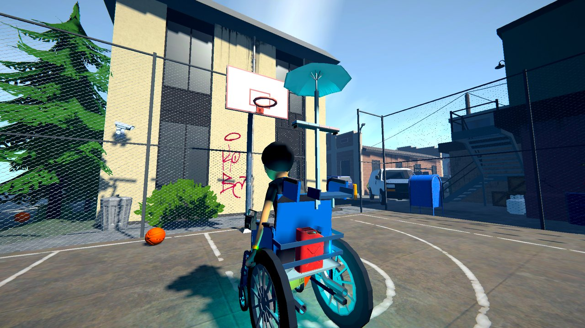
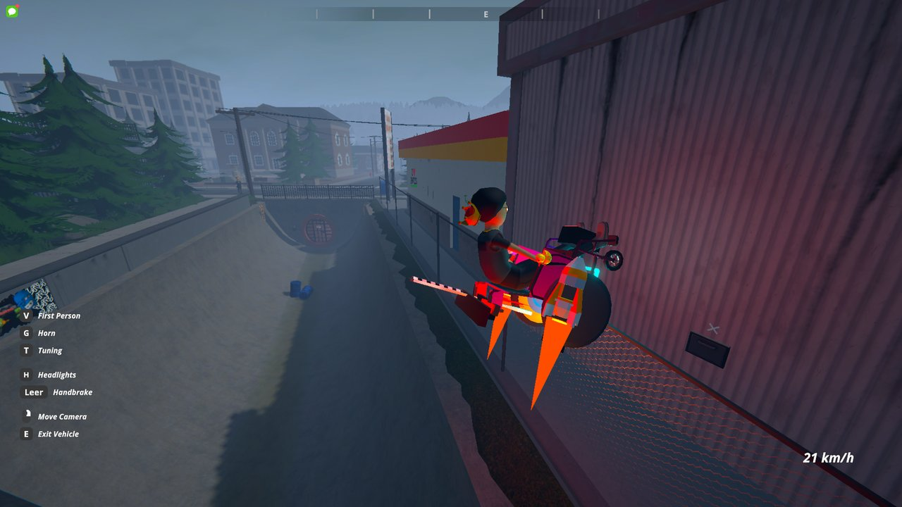
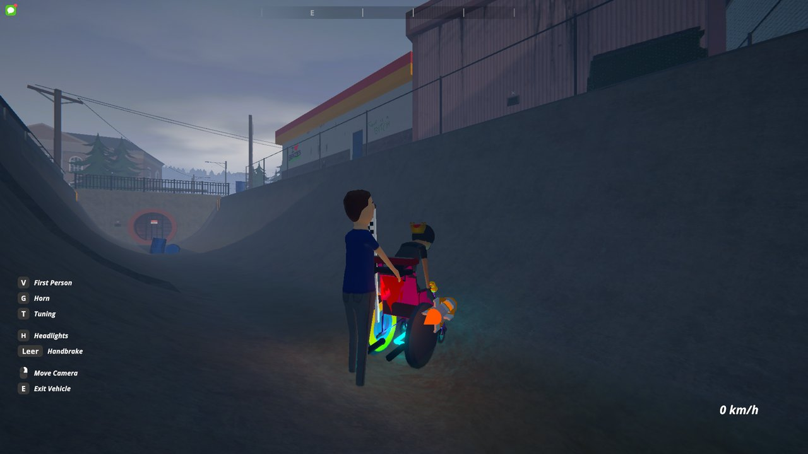
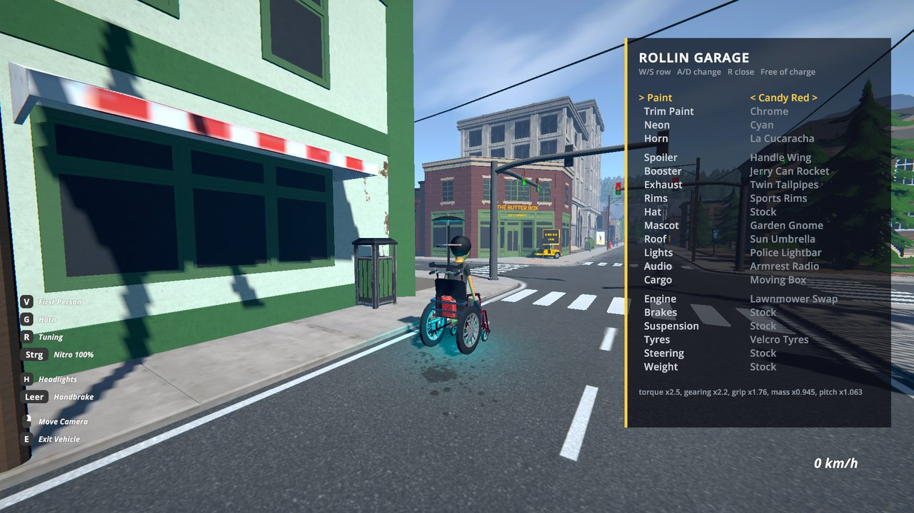

# Rollin - Tuned Wheelchairs for Schedule I

> 🛟 **Need help or found a bug?** Get support at [support.doodesch.de/rollin](https://support.doodesch.de/rollin).

> Sit down in any wheelchair in Hyland Point and roll. A friend can grab the handles and push. Then bolt a rocket to
> the back, put a crown on, and honk La Cucaracha at the police.

## Features

- Every wheelchair standing around the map gets a **Sit** prompt. Sit down and drive it with W, A, S and D; your hands
  turn the push rims.
- A second player can walk up behind an occupied chair and press **Push**. The pusher steers and pushes with their own
  movement keys, and the rider can still roll along. Press Interact again to let go.
- Press **T** while you sit in a chair for the tuning menu. W and S pick a row, A and D change it. Tuning is free.
- Everything is synced in co-op: who sits, who pushes, and every part on every chair. The host keeps each chair's
  tuning with the save.
- Get up and the chair is a normal prop again. Sit down in it later and its tuning is back.

## Tuning

| Slot | Parts |
|---|---|
| Paint, Trim Paint | Hot Pink, Toxic Lime, Gold, Chrome, Matte Black, Candy Red, Baby Blue, Royal Purple, Hospital Green |
| Neon | Pink, Cyan, Green, Red, Purple, White |
| Horn | Clown Horn, Rubber Duck, Freight Train, Charge!, La Cucaracha, Bicycle Horn |
| Spoiler | GT Wing, Drag Wing |
| Booster | Rocket Booster, Twin Boosters (flames, light and thrust sound) |
| Exhaust | Twin Tailpipes, Truck Stacks (they backfire when you brake hard) |
| Rims | Racing Rims, Monster Truck Tyres, Murdered-Out Rims |
| Hat | Royal Crown, M'lady Fedora, Traffic Cone (it sits on the rider's head) |
| Mascot | Rubber Duck, Mega Duck |
| Roof | Emergency Umbrella, Satellite Dish, Checkered Flag |
| Lights | Police Lightbar |
| Audio | Subwoofer, Boombox |
| Cargo | Shopping Basket, Cup Holder Big Gulp |
| Decal | Flame Job |
| Engine | Caffeine Drip, Lawnmower Swap, Jet Turbine, Illegal Rocket |
| Brakes | Heel Drag Pads, Anchor Brakes |
| Suspension | Slammed, Monster Lift |
| Tyres | Buttered Tyres (drift), Velcro Tyres (grip) |
| Steering | Shopping Cart Steering |
| Weight | Carbon Fibre Cushion, Lead Underpants |

## Requirements

- [MelonLoader](https://melonwiki.xyz/) 0.7.3 or newer
- [Chassis](https://github.com/DooDesch-Mods/ScheduleOne-Chassis), the vehicle framework Rollin is built on.
  Without Rollin, Chassis leaves the wheelchairs as props.

## Installation

1. Install MelonLoader and Chassis.
2. Put `Rollin.dll` into the game's `Mods` folder.
3. In co-op, every player needs Rollin.

## For mod authors

Rollin uses only the public Chassis API: a vehicle profile for the seat and the handles, `PoseAsPusher` for the
pusher's body, and `RegisterTuningPart` for every part. It is a working example of a modded vehicle with its own
tuning parts. The Debug build adds the console command `rollin` (`rollin help` lists everything).

## Credits

All models and sounds are CC0, by Kenney, Quaternius, iPoly3D, CreativeTrio, hat_my_guy, Pichuliru and AntumDeluge.
Sources are listed in [CREDITS.md](CREDITS.md).

## License

See [LICENSE.md](LICENSE.md).

This mod is written with help from generative AI tools (Anthropic Claude, OpenAI Codex).
